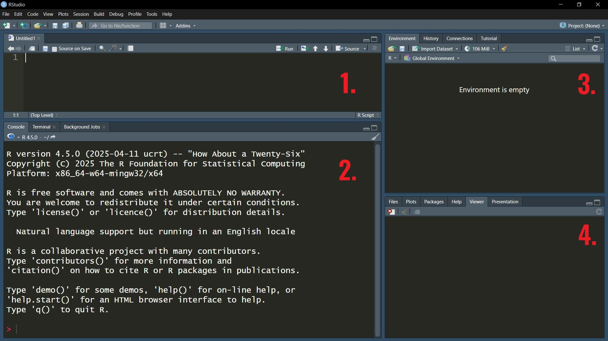

## Platforms

You may author your products within any text editor (including, for example, minimalist Windows- or Mac-based editors such as `notepad` or `TextEdit`).
However, most authors will prefer to use an integrated development environment (IDE).  

Popular IDEs that facilitate literate programming while also permitting the scripting of analytical languages (e.g., R, Python and Julia) include:

:::{.columns}

::: {.column width="50%"}

-   [RStudio](https://posit.co/download/rstudio-desktop/) 
-   [Positron](https://positron.posit.co/) 

:::

::: {.column width="50%"}

-   [VS Code](https://code.visualstudio.com/) 
-   [JupyterLab](https://jupyter.org/) 

:::

:::

This is not an exhaustive listing. *Many* alternative IDE options exist as of `{r} format(Sys.time(), "%B %Y")`. Your choice of IDE is not limited to any of the above--listed options. However, if you prefer an alternative IDE, please let the instructor know so he/she can:

1.  better assist you, and
2.  (very likely) learn about the IDE him/herself

### R Studio 

R Studio and Positron are both developed and supported by [Posit](https://posit.co/), which describes itself as an "open--source data science company". There are many support structures provided by Posit that assist the deployment of literate programming principles, and one--third of the organization's mission includes scientific communication.  

R Studio is the IDE used throughout this book when examples or screenshots are provided -- not because of any feature advantage over the other options, but rather because it is also the IDE used during the creation of this book!

The R Studio interface consists of four default "panes". @fig-platformrstud displays these panes, although take note that the screenshot image also has an appearance that has been customized to the author's preference (for example, the "black" background color scheme is not an IDE option that you will encounter when **YOU** first interact with R Studio).

{#fig-platformrstud}

Pane #1 is where you write -- *what* you write can take many different forms (aka file *type*). Pure R analyses are traditionally carried out within a *script* file associated with the `.R` file extension. If you choose Python rather than R, the script extension will be `.py`. You can write plain text `.txt`, markdown `.md`, and many other *types* of content here. Within the context of literate programming, we will primarily be working with Quarto (`.qmd`) and R Markdown (`.Rmd`) file types, and we will be scripting those files within the Pane #1 space. 

Pane #2 contains multiple tabs (as do pane #'s 3 and 4 -- the scripting pane is the only space solely dedicated to one purpose [scripting]). The primary tab is the console -- this is the same interactive environment that exists within the base programming package graphical user interface (e.g., this echoes what you would encounter if opening R "outside" of any IDE). You can type `2+2` here and, when you engage the "Return" button, the console will return a value (`4`). The console assumes you would like to communicate using R, although this can be toggled. The "Terminal" and "Background Jobs" tabs become more consequential when using R Studio as a literate programming platform, so we'll revisit those eventually, but for now, it's sufficient to think of pane #2 as primarily offering access to the language console.

Pane #3 presents information of relevance to your current working session. If you are new to R Studio, you will likely gravitate toward the "Environment" tab. Here you will see the elements of your session that have been created (objects -- named vectors, variables, and datasets). There is additional functionality within the "Environment" tab, but it is ok to prioritize the comfortable feedback provided by "knowing what's going on".  
Pane #4 provides a file explorer that reveals files and folders that are located within your personal computer's working directory. There are also default tabs for package management and general help with language definitions. The "Viewer", "Presentation", and "Plots" tabs are important for visual feedback of constructed products such as figures and documents. We will be relying heavily on the "Viewer" tab, which typically provides the cleanest preview of products created using these literate programming principles. 

### Positron 

### VS Code 

### JupyterLab 

JupyterLab is intended to facilitate the creation of digital notebooks (that have analytical components).  

## Version Control

Here are the top 5 version control platforms particularly suited for data scientists:

### DVC (Data Version Control)

This open-source tool is specifically designed for managing data, models, and experiments in machine learning projects.
It provides a Git-like experience for versioning data, which is crucial for reproducibility and collaboration in data science.
DVC works on top of Git repositories and can use cloud storage for datasets and models, making it ideal for handling large data files.

### GitLab

While primarily known as a DevOps platform, GitLab offers robust version control with additional features tailored for data science projects.
It includes CI/CD pipelines that can be used for machine learning workflows, project management, and issue tracking, which are beneficial for coordinating complex data science projects.
GitLab also allows for private repositories, which is important for sensitive data.

### DagsHub

DagsHub is built for data scientists and machine learning engineers, integrating with tools like Git, DVC, MLflow, and Jenkins.
It offers a platform where you can version control code, data, models, and experiments all in one place.
It provides easy data access, experiment tracking, and model registry, making it a comprehensive solution for collaborative data science work.

### Pachyderm

Pachyderm is another platform that excels in data versioning, particularly for machine learning workflows.
It offers a Git-like workflow for versioning not just code but also data, ensuring reproducibility and traceability.
Pachyderm can manage petabytes of data, supports incremental processing, and has features for parallelization, which are vital for scaling data science projects.

### lakeFS

An open-source data lake versioning system, lakeFS provides Git-like semantics for managing data in data lakes.
It supports various data formats and integrates with orchestration tools commonly used in data science, like Airflow and Kubeflow.
It's designed for teams needing to version control large volumes of data across different cloud storage solutions.

These platforms stand out by offering features that address the specific needs of data scientists, such as handling large datasets, model versioning, experiment tracking, and facilitating collaboration on data-driven projects.

Here's a contrast between GitHub and the top 5 version control platforms for data scientists:

GitHub General Purpose: GitHub is primarily designed for code version control, collaboration, and open-source software development.
It's not specifically tailored for managing large datasets or machine learning experiments.
Data Handling: GitHub has limitations with file size (max 2 GB per file with Git LFS for larger files), making it less suitable for versioning large datasets directly.
Integration: While GitHub Actions can be used for CI/CD, including for data science projects, it lacks native integration with data versioning tools like DVC out of the box.
Experiment Tracking: GitHub doesn't have built-in tools for tracking ML experiments or managing model versions.
This functionality would need to be added through third-party integrations or custom setups.
Cost: Free for public repositories; private repositories and additional features like GitHub Advanced Security come at a cost for larger teams or enterprises.

1.  DVC (Data Version Control) Specialization: DVC extends Git's capabilities specifically for data versioning. It tracks data changes but stores the actual data externally (e.g., in cloud storage). Integration: Works seamlessly with Git, allowing you to use GitHub or any Git hosting for metadata while keeping data in separate storage solutions. Experiment Management: Offers features for experiment management, which GitHub does not natively support.

Cost: Open-source and free, but you need to manage your data storage costs.

2.  GitLab All-in-One: GitLab integrates version control with CI/CD, project management, and issue tracking, which can be more comprehensive for data science projects than GitHub's offerings.
    Data Science Features: GitLab provides some native support for ML model versioning and can interact with DVC for data versioning, but it's not as specialized as DVC itself.
    Integration: Has built-in support for ML pipelines and can be more directly tailored for data science workflows out of the box compared to GitHub.
    Cost: Similar pricing model to GitHub, with free plans for public projects and paid plans for private ones.

3.  DagsHub Focused on ML: DagsHub is explicitly built for data scientists, providing a unified platform for code, data, and experiment versioning.
    Integration: Integrates with Git for code versioning, DVC for data versioning, and MLflow for experiment tracking, offering a more cohesive environment for ML projects compared to GitHub's broader software focus.
    Usability: Offers a GitHub-like interface but with added features for data science, making it easier for data scientists to manage their work.

Cost: Free for public projects, with paid plans for additional features like private repositories and increased data storage.

4.  Pachyderm Data Scale: Designed for versioning and processing large datasets, offering Git-like versioning for data at scale, something GitHub does not natively handle well.
    Workflow: Focuses on data lineage and reproducibility for ML workflows, providing a different paradigm than GitHub, which is more code-centric.
    Integration: Can integrate with GitHub for code but primarily works with data lakes or cloud storage for data versioning.
    Cost: Open-source with enterprise options for support and additional features.

5.  lakeFS Data Lake Focus: lakeFS is geared towards managing data in data lakes with Git-like operations, which is not a feature GitHub directly supports.
    Versioning: Allows versioning of raw data, which can be crucial for data science projects dealing with large datasets over time.
    Integration: Can link with GitHub for code management but focuses on data versioning in storage solutions like S3.
    Cost: Open-source, with an enterprise version for additional support and features.

GitHub is excellent for code versioning but falls short in directly handling the specific needs of data scientists dealing with: 

+ large datasets 
+ model versioning 
+ experiment tracking

Platforms like DVC, DagsHub, or Pachyderm provide more tailored solutions for these needs, integrating with or extending Git's functionality, while GitLab offers a broad platform with capabilities that can be adapted for data science. LakeFS addresses data versioning in data lakes uniquely compared to GitHub's code-centric approach.

## 11/17/26 Grok query

Here’s a concise map of the main contemporary platforms that support **code + prose** (literate-programming / computational narrative style), beyond Quarto and MyST/Jupyter Book.

### Tier 1: Most widely used today

| Platform              | Core idea                              | Languages                  | Typical outputs                  | Notes |
|-----------------------|----------------------------------------|----------------------------|----------------------------------|-------|
| **Jupyter / JupyterLab** | Interactive notebooks (.ipynb)        | Python, R, Julia, many others via kernels | HTML, PDF (via nbconvert), slides | The dominant interactive environment. MyST and Quarto both sit on top of it. |
| **R Markdown + knitr** | Classic “knit” workflow               | Primarily R (also Python/Julia via reticulate/etc.) | HTML, PDF, Word, slides, books (bookdown) | Still extremely popular in the R community; Quarto is its spiritual successor. |
| **bookdown**          | Multi-document books built on R Markdown | R (mainly)                | HTML books, PDF, EPUB            | The book-scale version of R Markdown. |
| **Sphinx + myst-parser / MyST-NB** | Documentation generator with MyST | Python-centric (any via extensions) | HTML, PDF, ePub, etc.           | Very mature; Jupyter Book 1 was built on this stack. Still heavily used for software docs. |

### Tier 2: Strong contemporary alternatives

| Platform              | Core idea                              | Strengths                                      |
|-----------------------|----------------------------------------|------------------------------------------------|
| **marimo**            | Reactive Python notebooks stored as pure `.py` | Reproducible, git-friendly, reactive (like a spreadsheet), can run as apps/scripts. Growing fast. |
| **Observable**        | Reactive notebooks (JavaScript/TypeScript) | Excellent for interactive data visualization and web-native storytelling. |
| **Wolfram Notebooks** | Full computational documents           | Extremely rich symbolic + numeric computation; closed ecosystem. |
| **MATLAB Live Scripts** | Interactive documents in MATLAB       | Strong in engineering/academia where MATLAB dominates. |
| **Emacs Org-mode + Babel** | True literate programming (tangle + weave) | Extremely powerful, language-agnostic, bidirectional. Niche but devoted users. |

### Tier 3: Notable or specialized

- **Pweave** — Python equivalent of Sweave/knitr (Markdown/LaTeX + Python).
- **noweb / Literate** — Classic or modern Knuth-style systems (tangle/weave, language-agnostic).
- **AsciiDoc + Antora** — Strong for technical documentation (less “executable notebook,” more structured docs with includes).
- **Docusaurus / VitePress / MkDocs** with embedded notebooks or code execution plugins — more documentation-site oriented.
- **Curvenote** — Commercial/publishing layer that uses MyST under the hood.
- **Pluto.jl** (Julia) — Reactive notebooks similar in spirit to marimo.

### Quick guidance for a survey

If you want the **most representative contemporary set** of “code + prose” systems that people actually use for documentation, teaching, or research, the core list is usually:

1. Jupyter / JupyterLab  
2. Quarto  
3. MyST / Jupyter Book  
4. R Markdown + knitr / bookdown  
5. Sphinx (+ myst-parser)  
6. marimo (rising)  
7. Org-mode (classic literate programming still in active use)

Would you like me to expand any of these with their typical admonition/callout syntax, or focus on a particular dimension (publishing quality, interactivity, multi-language support, version-control friendliness, etc.)?